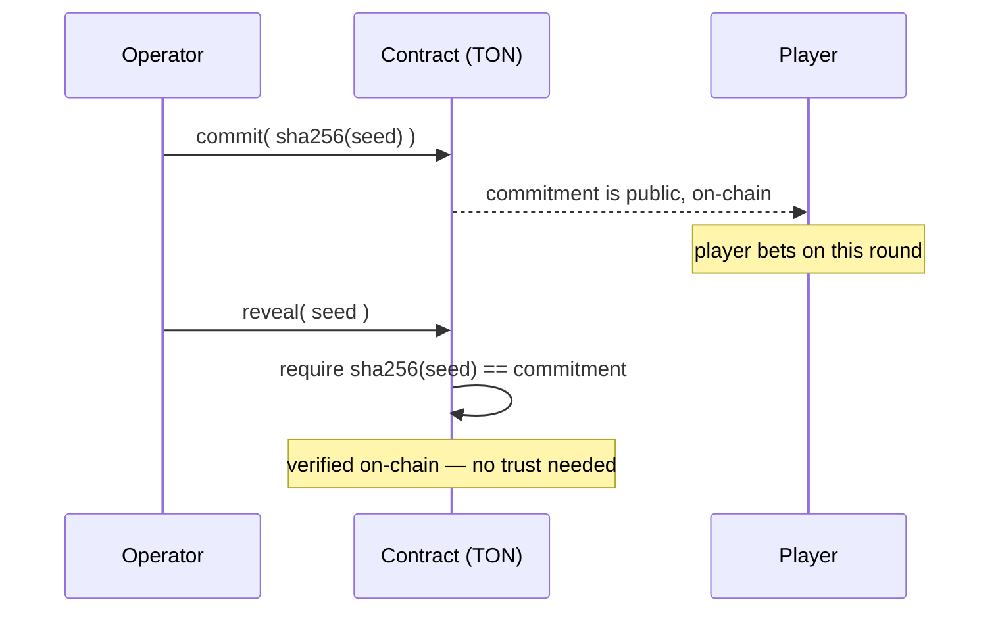

# ton-abyss

  

A tiny provably-fair verifier that lives **on-chain**. The operator commits to a
hashed seed before a round and reveals it after — and the smart contract itself
checks the reveal, so players don't have to take anyone's word for it.

It's the on-chain half of a crash casino I've been building
([abyss-casino](https://github.com/vladslugin/abyss-casino) is the off-chain
game). Same fairness math, same `SHA-256`, now enforced by a TON contract in Tact.

## How it works



The nice part: `sha256` inside the contract produces the **exact same hash** as
the server and the browser. So a commitment computed off-chain can be verified
right on TON — that's what the first test checks.

## Tests

```
Fairness (on-chain provably-fair verifier)
  ✓ external sha256 matches the on-chain commitment
  ✓ accepts a correct reveal and marks the round verified
  ✓ rejects a reveal that does not match the commitment
  ✓ only the owner can commit
  ✓ supports multiple rounds via reset

Tests: 5 passed, 5 total
```

## Run it

```bash
npm install
npx blueprint build Fairness     # compile the Tact contract
npx blueprint test               # run the sandbox tests
```

Deploy to testnet:

```bash
npx blueprint run deployFairness --testnet
```

## Contract

`contracts/fairness.tact` — the whole thing is ~60 lines:

- `commit(hash)` — publish `sha256(server_seed)` before the round
- `reveal(seed)` — contract enforces `sha256(seed) == commitment`
- `reset(hash)` — start a new round
- getters: `commitment`, `verified`, `roundsPlayed`, `owner`

Only the owner can commit or reveal; a mismatched seed is rejected by the VM.

## What's next

Right now the contract verifies fairness. The plan is to move the crash
multiplier derivation on-chain too, then hold bets in escrow and pay out
automatically — and wrap the whole thing in a Telegram Mini App.

## License

MIT
