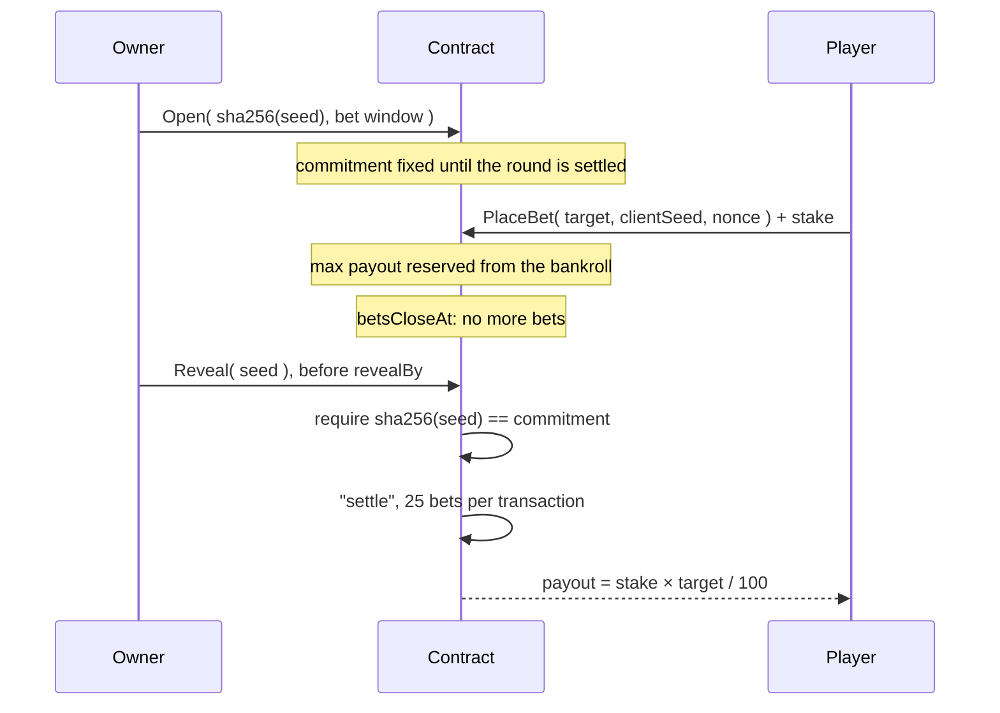

# ton-abyss

  

A provably-fair betting contract on TON, written in Tact. The owner commits to a
hashed seed before a round and reveals it after; the contract checks the reveal,
derives every bet's multiplier and pays the winners. It's the on-chain half of
[abyss-casino](https://github.com/vladslugin/abyss-casino), with the same formula.

The first version made the same promise and did not keep it: the owner could swap
the commitment after seeing the bets, 76 bets froze a round for good, and a few
other things. [What changed](#what-changed-after-the-audit) lists them; each one
has a test.

## A round



What the contract guarantees, without trusting the owner:

- **The seed is the one committed before the bets.** `Open` is only possible between
  rounds, so the commitment cannot change while bets are open or being settled.
- **Nobody bets on a known seed.** Bets close at `betsCloseAt`, and the seed is
  accepted only after that.
- **Withholding the seed does not help the owner.** If there is no reveal by
  `revealBy` (one hour after betting closes), anyone can send `"expire"` and every
  bet is paid as a win.
- **Every win is paid.** A bet is accepted only if the free bankroll covers its
  maximum payout, which stays reserved until the bet is settled. A payout that cannot
  be sent rolls back its batch, so it can be settled again instead of being lost.
- **Any number of bets settles.** Settlement runs in batches of 25. With the longest
  seeds and every bet winning, a batch takes about 516,000 gas, under the limit of
  1,000,000. The contract sends `"settle"` to itself until it is done; anyone can
  send it too. Both seeds are limited to 64 bytes, so a batch cannot get more
  expensive; if the owner committed to a longer seed, it cannot be revealed and the
  round expires.
- **The same edge for every target.** 1% from 1.01× to 100×:
  [how the multiplier works](docs/how-the-multiplier-works.md).

The owner can withdraw only between rounds and never below the float of 0.6 TON that
pays for settlement and storage.

## Limits and fees

| | |
|---|---|
| target | 1.01× to 100× |
| stake | at least 0.05 TON |
| bets per round | 1,000 |
| server and client seed | up to 64 bytes |
| bet window | 30 seconds to 24 hours |
| reveal window | 1 hour after betting closes |

0.02 TON of every bet stays in the contract to pay for settling it. In the sandbox,
settling a bet costs about 0.001 TON, so most of it goes to the bankroll: treat it
as a fee.

## Contract

`contracts/fairness.tact`:

- `Open(commitment, betWindow)`: owner, between rounds
- `PlaceBet(target, clientSeed, nonce)`: stake TON while betting is open
- `Reveal(serverSeed)`: owner, after betting closes and before `revealBy`
- `"expire"`: anyone, after `revealBy` without a reveal
- `"settle"`: settle the next batch
- `"fund"`, `Withdraw(amount)`: owner
- `crashPoint(clientSeed, nonce)`: the multiplier x100 (`247` = 2.47×) for the last
  revealed seed, 0 before a reveal
- getters: `phase` (0 idle, 1 open, 2 settling), `round`, `commitment`, `betsCloseAt`,
  `revealBy`, `revealedSeed`, `expired`, `betCount`, `settledCount`, `betAt(i)`,
  `reserved`, `freeBankroll`, `owner`

## Tests

```
rounds
  ✓ commits to sha256(seed) and sets the betting and reveal deadlines
  ✓ only the owner opens a round, and only when none is running
  ✓ does not open a round without the float that pays for settlement
  ✓ accepts the seed only after betting closes and before the reveal deadline
multiplier
  ✓ matches the off-chain formula, also for inputs longer than one cell
  ✓ rejects seeds longer than 64 bytes, and such a round expires
  ✓ gives every target from 1.01x to 100x the same 1% edge
bets
  ✓ pays a winning bet exactly stake × target / 100
  ✓ keeps the stake of a losing bet
  ✓ rejects targets outside 1.01x–100x and stakes below the minimum
  ✓ rejects a bet the bankroll cannot cover, and accepts it after funding
settlement
  ✓ settles 200 bets in batches of 25 and pays every winner
  ✓ pays every bet as a win when the owner does not reveal in time
owner
  ✓ withdraws only between rounds and never below the float
attacks on the first version, now
  ✓ the owner cannot replace the commitment after seeing the bets
  ✓ a crowded round still settles: 100 bets
  ✓ a win the bankroll could not cover is never accepted as a bet
  ✓ a second bet from the same wallet is kept and settled
  ✓ nobody can bet once the seed may be revealed

Tests: 19 passed, 19 total
```

## Run it

```bash
npm install
npx blueprint build Fairness     # compile the Tact contract
npx blueprint test               # run the sandbox tests
python3 docs/measure.py          # measure the multiplier, redraw the charts
```

Deploy to testnet:

```bash
npx blueprint run deployFairness --testnet
```

## What changed after the audit

Commit `10a64e2` adds tests that run these attacks against the first version; with
that commit checked out, they pass, which means each attack works.

| first version | now |
|---|---|
| `Commit` could be sent again while bets were open, so the owner could pick a seed after seeing them | the commitment is set by `Open`, only between rounds |
| `Reveal` paid every bet in one transaction; at 76 bets it ran out of gas, and with no refund or withdraw the stakes and the bankroll stayed locked | batches of 25, any number of bets |
| payouts used `SendIgnoreErrors`, so a win the bankroll could not cover was dropped and the bet deleted | the maximum payout is reserved when the bet is accepted |
| bets were stored per wallet, and a second bet replaced the first | every bet is stored separately |
| if the owner never revealed, the stakes were locked | after `revealBy` every bet is paid as a win |
| bets stayed open until the reveal arrived | bets close at `betsCloseAt`, and the reveal is accepted only after it |
| "1% edge" was the share of 1.00× crashes; the real edge was 0.01% to 1% depending on the target | 1% for every target |
| the build path `build\Fairness` only worked on Windows | `build/Fairness` |
| the contract and abyss-casino derived the multiplier differently | the same formula in both |

## What's next

A Telegram Mini App with a TON wallet on top of this, and a review by someone
other than me before it holds real money.

## License

MIT
