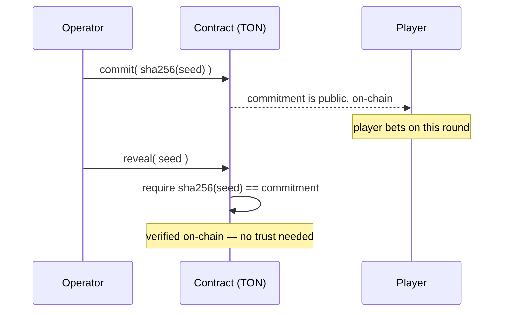

# ton-abyss

  

A tiny provably-fair verifier that lives **on-chain**. The operator commits to a
hashed seed before a round and reveals it after — and the smart contract itself
checks the reveal, so players don't have to take anyone's word for it.

It's the on-chain half of a crash casino I've been building
([abyss-casino](https://github.com/vladslugin/abyss-casino) is the off-chain
game). Same fairness math, same `SHA-256`, now enforced by a TON contract in Tact —
including the crash multiplier itself. Players stake TON on a round; when the
seed is revealed the contract derives the multiplier and pays out winners
automatically.

## How it works



The nice part: `sha256` inside the contract produces the **exact same hash** as
the server and the browser. So the commitment *and the multiplier* computed
off-chain can both be verified right on TON — the tests cross-check every round
against an independent off-chain implementation.

## The multiplier

How one SHA-256 hash becomes a fair multiplier with a 1% edge and a heavy tail:
**[docs/how-the-multiplier-works.md](docs/how-the-multiplier-works.md)** — a short line-by-line write-up with the distribution measured over 300k rounds.

## Tests

```
Fairness (on-chain provably-fair verifier)
  ✓ external sha256 matches the on-chain commitment
  ✓ accepts a correct reveal and marks the round verified
  ✓ rejects a reveal that does not match the commitment
  ✓ derives the crash multiplier on-chain, matching the off-chain formula
  ✓ returns 0 for the multiplier before the seed is revealed
  ✓ only the owner can commit
  ✓ pays out a winning bet automatically on reveal
  ✓ keeps the stake when the bet loses
  ✓ rejects a bet once the round is revealed
  ✓ supports multiple rounds via reset

Tests: 10 passed, 10 total
```

## Run it

```bash
npm install
npx blueprint build Fairness     # compile the Tact contract
npx blueprint test               # run the sandbox tests
```

Deploy to testnet:

```bash
npx blueprint run deployFairness --testnet
```

## Contract

`contracts/fairness.tact` — the whole thing is ~60 lines:

- `commit(hash)` — publish `sha256(server_seed)` before the round
- `placeBet(target, clientSeed, nonce)` — stake TON on a multiplier while the seed is hidden
- `reveal(seed)` — verify the seed, derive each bet's multiplier, pay out winners
- `"fund"` — owner tops up the bankroll
- `reset(hash)` — start a new round
- `crashPoint(clientSeed, nonce)` — the multiplier, derived on-chain (x100, so `247` = 2.47x)
- getters: `commitment`, `verified`, `roundsPlayed`, `betOf`, `owner`

Only the owner can commit or reveal; bets after a reveal are rejected by the VM;
payouts settle automatically in the same transaction as the reveal.

## What's next

Fairness, the multiplier, and bet escrow with automatic payouts all run
on-chain now. Next up is wrapping it in a Telegram Mini App with a TON wallet,
and batching payouts so a round can settle many players cheaply.

## License

MIT
