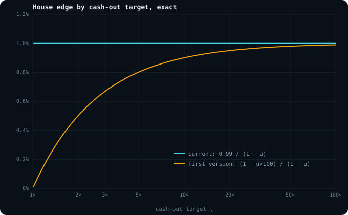

# How the crash multiplier works

A short write-up of the one function that decides every bet: how a single SHA-256
hash becomes a multiplier with the same 1% house edge at every target, and why it
can run inside a TON contract with no floating point at all.

The whole thing is this:

```tact
fun crashFrom(seed: String, clientSeed: String, nonce: Int): Int {
    let sb: StringBuilder = beginString();
    sb.append(seed);
    sb.append(":");
    sb.append(clientSeed);
    sb.append(":");
    sb.append(nonce.toString());
    let h: Int = sha256(sb.toString()) >> 204;     // top 52 bits
    return max(99 * E / (E - h), 100);              // E = 2^52
}
```

## 1. Build the input

Every bet is identified by three things: the secret `seed` (hidden until the reveal),
the player's `clientSeed` and a `nonce`. Joining them as `seed:client:nonce` gives
every bet a unique input. The player's seed is in there on purpose: the owner commits
to the seed before any bet, so it cannot pick a seed that is bad for a bet it has not
seen yet.

The string can always be split back into its parts: the seed is hex and the nonce is
digits, so neither contains a colon.

## 2. Hash it

```tact
let h: Int = sha256(sb.toString()) >> 204;   // 256 - 52 = 204
```

SHA-256 turns the string into a 256-bit number that nobody can steer. Same string in,
same hash out: on the contract, on the server, in the browser. Shifting right by 204
keeps the top 52 bits, so `h` is a uniform integer in `[0, 2^52)`. 52 bits is also the
largest integer a double holds exactly, which keeps a JavaScript client simple.

One detail matters here. Tact's `sha256()` hashes the whole string, also when it
spans several cells (longer than 127 bytes). The cheaper `hashData()` only hashes the
first 127 bytes, and with a long client seed it would give a different number than
every off-chain implementation. That is not an edge case: a seed of 64 hex
characters and a 64-byte client seed already make a 140-byte string. The tests check
such an input against an independent implementation.

## 3. The formula

```tact
max(99 * E / (E - h), 100)
```

Write `u = h / E`, so `u` is uniform in `[0, 1)`. The result is `0.99 / (1 − u)` in
hundredths of a multiplier, rounded down: `100` means 1.00×, `247` means 2.47×.

- A result of at least `T` hundredths needs `h ≥ E − 99E/T`, which holds for
  `floor(99E/T)` of the `E` equally likely values of `h`. So
  `P(crash ≥ t) = 0.99 / t`.
- A bet on `t` pays `t` times the stake, so its expected return is
  `t × 0.99 / t = 0.99`. The edge is 1% for every target from 1.01× to 100×, and the
  tests check that for all 9,900 targets exactly, not by sampling.
- About 1.98% of rounds end at 1.00×, where every bet loses. The median is 1.98×.

No floats anywhere: the TON VM doesn't have them, and it doesn't need them.

### Measured

300,000 rounds through the contract formula (`python3 docs/measure.py`):


| cash-out target | measured | theory `0.99/t` |
|-----------------|----------|-----------------|
| 1.01× | 98.01% | 98.02% |
| 1.5×  | 65.95% | 66.00% |
| 2×    | 49.53% | 49.50% |
| 3×    | 32.88% | 33.00% |
| 5×    | 19.71% | 19.80% |
| 10×   |  9.89% |  9.90% |
| 50×   |  2.00% |  1.98% |
| 100×  |  1.00% |  0.99% |

## What the first version got wrong

The first version used `(100E − h) / (E − h)`, which is `(100 − u) / (1 − u)`. It
crashes at 1.00× in exactly 1% of rounds, and this document called that the house
edge. It is not. For that formula `P(crash ≥ t) = 0.99 / (t − 0.01)`, so the expected
edge depends on the target:



| target | edge, first version | edge, now |
|--------|---------------------|-----------|
| 1.01× | 0.01% | 1.00% |
| 1.5×  | 0.34% | 1.00% |
| 2×    | 0.50% | 1.00% |
| 10×   | 0.90% | 1.00% |
| 100×  | 0.99% | 1.00% |

The measurements had shown it all along: the old table listed 49.70% at 2× against
a "theory" of 49.50%, and `0.99 / (t − 0.01)` gives 49.75%. The difference looked like
noise, so nobody checked the theory.

## 4. Same numbers off-chain

The reason this can be trusted is that the contract is not the only thing that can
compute it. The tests use this TypeScript copy to check the contract:

```ts
const E = 1n << 52n;
function crash(seed: string, client: string, nonce: number): bigint {
    const h = BigInt('0x' + sha256(`${seed}:${client}:${nonce}`).toString('hex')) >> 204n;
    const x100 = (99n * E) / (E - h);
    return x100 < 100n ? 100n : x100;
}
```

The off-chain game, [abyss-casino](https://github.com/vladslugin/abyss-casino), uses
the same formula in Python and in the browser, so any of its rounds can be checked
with the contract's `crashPoint` getter once the seed is revealed.

---

*Part of [ton-abyss](../README.md).*
