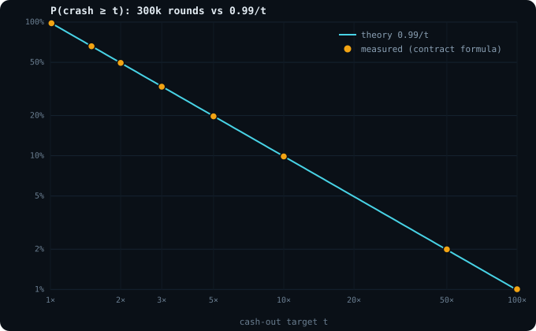

# How the crash multiplier works

A short write-up of the one function that decides every round — how a single
SHA-256 hash becomes a fair multiplier with a 1% house edge and a heavy tail,
and why it can run inside a TON contract with no floating point at all.

The whole thing is this:

```tact
fun crashFrom(seed: String, clientSeed: String, nonce: Int): Int {
    let sb: StringBuilder = beginString();
    sb.append(seed);
    sb.append(":");
    sb.append(clientSeed);
    sb.append(":");
    sb.append(nonce.toString());

    let hash: Int = sha256(sb.toString());
    let h: Int = hash >> 204;              // top 52 bits
    if (h == 0) { h = 1 }

    let x100: Int = (100 * E - h) / (E - h);   // E = 2^52
    if (x100 < 100) { x100 = 100 }
    return x100;
}
```

Let me go through it line by line.

## 1. Build the round's input

```tact
sb.append(seed); sb.append(":"); sb.append(clientSeed); sb.append(":"); sb.append(nonce.toString());
```

Every round is identified by three things: the secret `seed` (hidden until
reveal), the player's `clientSeed`, and a `nonce` that counts up each round.
Joining them as `seed:client:nonce` gives every round a unique input. The
player's seed is in there on purpose — it stops the operator from picking a
seed that produces nice numbers for itself.

## 2. Hash it

```tact
let hash: Int = sha256(sb.toString());
```

SHA-256 turns that string into a 256-bit number that is, for all practical
purposes, uniformly random and impossible to steer. Same string in, same hash
out — on the contract, on the server, in the browser. That determinism is the
whole point: anyone can recompute it.

## 3. Take the top 52 bits

```tact
let h: Int = hash >> 204;   // 256 - 52 = 204
```

We only need a slice of that entropy. Shifting right by 204 keeps the top 52
bits, so `h` is a uniform integer in `[0, 2^52)`.

Why 52? It's the width [bustabit](https://bustabit.com) uses, and it's the
largest integer a double can hold exactly — handy if you ever want a JS client
to match without BigInt surprises. `E = 2^52 = 4503599627370496`.

## 4. The formula

```tact
let x100: Int = (100 * E - h) / (E - h);
```

This is the part that looks like magic. Write `u = h / E`, so `u` is uniform in
`[0, 1)`. Then:

```
(100E − h) / (E − h)  =  (100 − u) / (1 − u)
```

- when `u → 0`   → `100`   (i.e. 1.00×, the floor)
- when `u = 0.5` → `199`   (1.99×)
- when `u → 1`   → `∞`     (rare huge multipliers — the heavy tail)

Integer division floors the result, and everything is `×100`, so `247` means
`2.47×`. No floats anywhere — the TON VM doesn't have them, and it doesn't need
them.

### Where the 1% edge hides

The result equals exactly `100` (a `1.00×` instant crash) when

```
(100E − h) / (E − h) < 101   ⟺   h < E / 100
```

`h` is uniform on `[0, E)`, so that's a clean **1% of rounds**. No separate
"house edge" branch bolted on — it falls straight out of the formula.

### The survival curve

Solving `result ≥ t` gives `P(crash ≥ t) = 0.99 / t`. That's a power law: on a
log-log plot it's a straight line. I ran 300,000 rounds through the exact
contract formula and plotted the measured probabilities against `0.99/t`:



The dots (measured) sit right on the line (theory) across two orders of
magnitude. Numbers:

| cash-out target | measured | theory `0.99/t` |
|-----------------|----------|-----------------|
| 1.5× | 66.42% | 66.00% |
| 2×   | 49.70% | 49.50% |
| 3×   | 33.13% | 33.00% |
| 5×   | 19.85% | 19.80% |
| 10×  |  9.95% |  9.90% |
| 50×  |  2.01% |  1.98% |
| 100× |  0.99% |  0.99% |

Instant `1.00×` came out at **0.99%** against a 1.00% target, and the median
round is **1.98×**. The math holds.

## 5. Same numbers off-chain

The reason this can be trusted is that it isn't only the contract that can
compute it. Here's the identical formula in TypeScript, which the test suite
uses to cross-check every round:

```ts
const E = 4503599627370496n; // 2^52
function crash(seed: string, client: string, nonce: number): bigint {
    const hash = BigInt('0x' + sha256(`${seed}:${client}:${nonce}`).toString('hex'));
    let h = hash >> 204n;
    if (h === 0n) h = 1n;
    let x100 = (100n * E - h) / (E - h);
    return x100 < 100n ? 100n : x100;
}
```

The test asks the contract for a multiplier and compares it to this function
for several nonces. They match byte for byte — which means a player never has
to trust the operator's number. They can recompute it themselves, or read it
straight off the chain.

---

*Part of [ton-abyss](../README.md). The off-chain game is
[abyss-casino](https://github.com/vladslugin/abyss-casino).*
